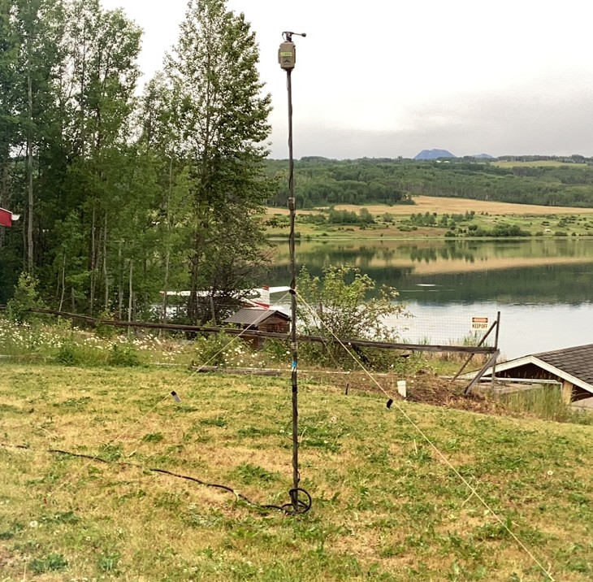
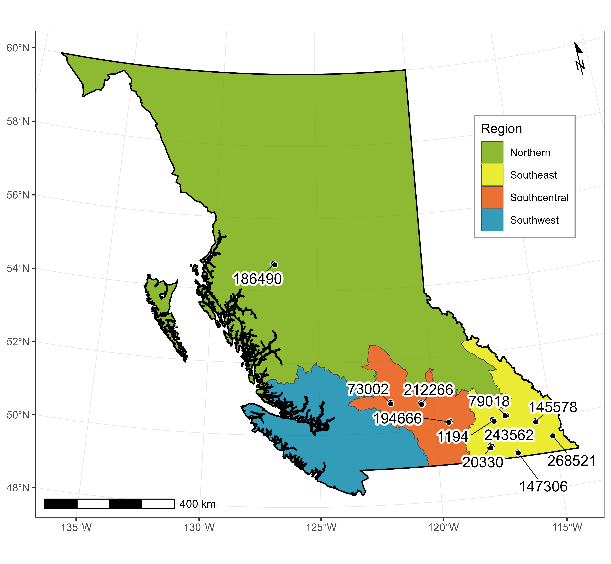

# **Abstract**

# **Introduction**

Passive acoustic monitoring has become a valuable tool for surveying species that are otherwise difficult or labour-intensive to sample. Bats are a good example as their nocturnality and mobility make them hard to observe directly, and conventional survey methods such as mist netting require substantial field effort for relatively few detections[@weller2007]. Ultrasonic recorders instead capture echolocation calls passively, yielding far more detections per unit of effort [@hohoff2024] . As a result, acoustic monitoring now underpins a growing body of research on bat behaviour, habitat use, and ecology [@roemer2025; @geng2026].

The North American Bat Monitoring Program (NABat) was established to make use of the low effort- high reward of acoustic monitoring, coordinating acoustic sampling across thousands of sites and hundreds of partner organizations to track continental trends in North American bat populations [@loeb2015]. Because participation is distributed, the recorders themselves are not standardized: partners deploy whichever make or model of autonomous recording unit (ARU) they have available, and manufacturers release updated models every few years. The pool of equipment contributing to NABat is therefore neither uniform across sites nor stable over time.

Detector model is not a trivial source of variation. Studies comparing units side by side have consistently found differences in the number of calls recorded, detection probability, and species richness [@adams2012; @fenton2001; @parsons1996; @kaiser2015; @perea2020; @perks2025]. @adams2012 found that the Anabat SD2 detected no synthetic signals above 55 kHz, unlike the SM2BAT, implying poorer performance for high-frequency callers; @kaiser2015 observed the corresponding pattern in the field, with SM2BAT units acquiring more Myotis-group data than paired Anabat SD2 units. Interestingly, @kaiser2015 also reported greater detection distances for the Anabat SD2 microphone at low and mid-range frequencies compared to the SM2BAT. Critically, the magnitude and even the direction of these differences depend on deployment context including microphone orientation, weatherproofing, and habitat around deployments [@kaiser2015; @adams2012; @perks2025] . Correction factors are therefore not readily transferable between programs, and the effect of a given equipment change is best quantified within the monitoring network where it occurred.

British Columbia has contributed to NABat since 2016, using the resulting data both to support continental models and to fit provincial trend models [@rae2024; @hurtado2026BC]. Most sites have been sampled with consistent equipment throughout: the 31 sites considered here were surveyed with Wildlife Acoustics SM2BAT from 2015 to 2024. In 2025, a provincial equipment refresh replaced these with Titley Chorus recorders. This transition created both a need and an opportunity: a need to quantify how much of any subsequent change in recorded activity is attributable to the detector rather than the bat community, and an opportunity to do so under realistic field conditions rather than in a playback trial.

# **Methods**

## **Study design**

We used data collected at 31 NABat sites across British Columbia between May 23 to July 8 2025 (@fig-map). Most sites were in southeastern and south-central BC, with a few in the north. At each site, we deployed two recorder types, a Wildlife Acoustics Song Meter SM2Bat+ (SM2) and a Titley Scientific Chorus (Chorus), following the NABat protocol and the provincial standards for British Columbia [@loeb2015; @hurtado2026BC]. The SM2, fitted with an SMX-U1 microphone, which was mounted at the top of a \~3 m pole, and the Chorus was mounted directly below it (@fig-deployment). Both units recorded for at least seven consecutive nights using comparable acoustic settings ([Appendix A]).

{#fig-deployment}

```{r}
#| label: set up for map
#| fig-width: 6.5
#| fig-height: 6.5
#| dpi: 300
#| echo: false
#| message: false
#| warning: false
#| include: false

#this is the code of how the map was created. Left it here in case it is needed, but code does not need to run.
library(sf)
library(dplyr)
library(ggplot2)
library(ggrepel)
library(ggspatial)

region_colors <- c(
  "Northern"     = "#70A800",
  "Southeast"    = "#E6E600",
  "Southcentral" = "#E64C00",
  "Southwest"    = "#0084A8"
)

# --- Regions --------------------------------------------------------------
bc_regions <- st_read("Data/Raw/BCRegions.shp", quiet = TRUE)
if (is.na(st_crs(bc_regions))) st_crs(bc_regions) <- 4326

# Find the column holding the region names
name_col <- names(st_drop_geometry(bc_regions))[
  vapply(st_drop_geometry(bc_regions),
         function(x) all(as.character(x) %in% names(region_colors)), logical(1))
]
bc_regions$Region <- if (length(name_col) > 0) {
  as.character(bc_regions[[name_col[1]]])
} else {
  c("Northern", "Southcentral", "Southeast", "Southwest")
}

bc_regions <- bc_regions |>
  st_make_valid() |>
  st_transform(3005) |>                     # BC Albers, standard for BC maps
  mutate(Region = factor(Region, levels = names(region_colors)))

# Provincial border = outline of all regions dissolved together
bc_border <- st_union(bc_regions)

# --- Sites ----------------------------------------------------------------
sites <- read.csv("Data/Raw/SiteSummaries/SiteLoc.csv", check.names = FALSE) |>
  st_as_sf(coords = c("Longitude", "Latitude"), crs = 4326) |>
  st_transform(3005)

# One label per GRTS cell, placed at the centre of its quadrant points
cell_labels <- sites |>
  group_by(`GRTS Cell ID`) |>
  summarise(geometry = st_centroid(st_union(geometry)), .groups = "drop")

# --- Map ------------------------------------------------------------------
site_map <- ggplot() +
  geom_sf(data = bc_regions, aes(fill = Region), colour = "grey30",
          linewidth = 0.2, alpha = 0.8) +
  geom_sf(data = bc_border, fill = NA, colour = "black", linewidth = 0.5) +
  geom_sf(data = sites, shape = 21, fill = "black", colour = "white",
          size = 1.8, stroke = 0.4) +
  geom_text_repel(
    data = cell_labels,
    aes(label = `GRTS Cell ID`, geometry = geometry),
    stat = "sf_coordinates", size = 4, min.segment.length = 0,
    segment.size = 0.25, box.padding = 0.4, max.overlaps = Inf,
    bg.color = "white", bg.r = 0.2
  ) +
  scale_fill_manual(values = region_colors, name = "Region", drop = FALSE) +
  labs(x = NULL, y = NULL) +
  theme_bw(base_size = 10) +
  theme(
    legend.position = c(0.86, 0.70),
    legend.background = element_rect(fill = "white", colour = "grey60"),
    panel.grid = element_line(colour = "grey90", linewidth = 0.2)
  )

site_map <- site_map +
  annotation_scale(location = "bl", width_hint = 0.25) +
  annotation_north_arrow(
    location = "tr", which_north = "true",
    height = unit(0.9, "cm"), width = unit(0.9, "cm"),
    pad_y = unit(0.3, "cm"),
    style = north_arrow_minimal()
  )
ggsave("Figures/fig_mapsites.png", site_map, width = 6.5, height = 6, dpi = 600)
```

{#fig-map fig-env="fig-map"}

Acoustic data were processed following the British Columbia provincial protocol [@hurtado2026BC; @rae2024]. All recordings were first processed with Kaleidoscope Pro (Bats of North America classifier, v5.4.0) and SonoBat 30 (Northwestern British Columbia classifier). This filtered out files without bat echolocation pulses and assigned a preliminary species identification to the rest. Following @hurtado2026BC, approximately 50% of recordings for each site and recorder type were then manually verified according to the standards of @reichert2018.

Each of the following statistical analyses used a different version of this dataset. Species- and community-level comparisons between recorders used the automated classifications from both SonoBat and Kaleidoscope. Activity models used Kaleidoscope classifications only. Dynamic occupancy models used manually verified identifications only.

## **Statistical analysis**

### Species-level models

To analyze our data we created two models, one at the species level and one at the community level. For the species level analysis we used negative binomial generalized linear mixed models (GLMM) to test the difference between the Anabat Chorus and the SM2-Swift at detecting the 16 species across the 24 sites at the night level. To run the species-specific GLMM, we filtered the raw data set into rows that gave the exact number of calls for a particular species at a particular night and site. We renamed this filtered dataset “night_counts” and it contained 6592 observations. We included a fixed effect for detector type, and a random effect for sites because multiple samples were collected from the same site. 

We tested the temporal aggregations by subsetting our raw dataset into two temporal bins: 10 minutes bin and 1 hour bin. We used our “night_counts” dataset for the full night bin. The 10 minute bin contained 153248 observations and the 1 hour bin contained 41648 observations. We run GLMMs at these three temporal scales to test whether the detection bias arose at particular temporal scales. For these GLMMs we included a nested random effect (1\|site_id/night) for sub-nightly scales, because samples were taken from multiple nights per site. We visualized the results of the GLMM using intraclass correction coefficient (ICC), which looks at the agreement between the Anabat Chorus and the SM2-Swift at detecting the same species across the 24 sites for each temporal aggregation. An ICC value of 1 means full agreement between the two recorders, entailing that there is no difference in detections across the temporal aggregations. An ICC value of 0 means no agreement between the two recorders, entailing that there is a difference in detections across the temporal aggregations.

### Community-level

For the community level analysis, we used the Jaccard-Sorensen and Bray-Curtis indices to test for a difference in the detections of community compositions between the two recorders for the 16 species at the 24 sites. The Jaccard-Sorensen index tells us if the same species are detected by the two recorders across the 24 sites, with 1 indicating that the species detected by the two recorders are identical and 0 indicating no overlap between the recorders. To run the Jaccard-Sorensen index, we reshaped our “night_counts” dataset to include sample_id, site_id, detector_type, and the 16 species. This reshaped data was named “wide” and it  contained 412 observations. We then split the wide dataset by detector type, to get two datasets with 206 observations each. We then paired these two datasets, which contained 206 observations and ran the Jaccard-Sorensen index. We visualized the results of the Jaccard-Sorensen index using boxplots which show the median similarly across all nights. 

Similarly, the Bray-Curtis index tells us if there is a difference between the two recorders in detecting the presence as well as the abundance of the 16 species across the 24 sites. We used a pre-manova and non-metric multidimensional scaling (NMDS2) plot to visualize community composition using the Bray-Curtis distance. For the Bray-Curtis index, we took our “wide” dataset and filtered for the species column to include just the numbers to create a species matrix. From the species matrix, we calculated the dissimilarity index from which the NMDS2 plot was created. 

We conducted all analyses in R (4.3.1 and R Core Team 2023), using dplyr for data cleaning and manipulation (Wickham et al. 2023), ggplot for creating plots (Wickham 2016), and DHARMa (Hartig 2024) to check model assumptions by assessing residuals. GLMMs were run using the glmer.nb function from the lme4 package (Douglas et al. 2015). Both the Jaccard-Sorensen and the Bary-Curtis indices were run using the vegan package (Oksanen et al 2025). 

### Testing modelling results

To evaluate how differences in species detectability between detector types affect our activity and occupancy trend estimates, we fit reduced versions of the current provincial models for British Columbia [@hurtado2026BC]. These models were restricted to sites where SM2 and Chorus units were deployed at the same time. We built two parallel datasets that were identical for 2016–2024. They differed only in the 2025 survey year, where detections came from either the Chorus or the SM2 unit at each site. Any difference between the models’ results can therefore be attributed to the detector used in the final year.

#### Activity Trend Models

The model structure followed the provincial activity models exactly [@hurtado2026BC]. These are negative binomial generalized linear mixed models (GLMMs) with species-specific covariates. Starting from the covariates established in the provincial models, we selected covariates by AIC-based stepwise selection, independently for the Chorus and SM2 datasets. Both selections produced the same top model for every species (@tbl-cov). Species tags were assigned using the automated classifications from Kaleidoscope following the methods from @hurtado2026BC.

```{r}
#| echo: false
#| warning: false
#| message: false
#| include: true
#| label: tbl-cov
#| tbl-cap: "Top-performing stationary models selected by AIC-based stepwise selection. Definitions of covariates are: Temperature = nightly temperature (°C); Wind speed = nightly mean wind speed (km/h); RH = nightly mean relative humidity (%); dd = cumulative degree days above 10 °C since January 1; Moon = proportion of the moon illuminated × proportion of the night the moon was above the horizon; Clutter = distance (m) to the nearest clutter object; Nearby water = whether the detector was within 100 m of water (1 = yes, 0 = no); I(YearS²) = quadratic year term allowing for non-linear temporal trends. A * B denotes the main effects of A and B plus their interaction." 

library(flextable)
library(dplyr)

# Using the Chorus output; SM2 output is the same
model_covariates <- read.csv("Data/Analyzed/ActivityModels/ModelVariables-Chorus.csv")

species_names <- c(
  ANPA = "Pallid Bat", COTO = "Townsend's Big-eared Bat", EPFU = "Big Brown Bat",
  EUMA = "Spotted Bat", LABO = "Eastern Red Bat", LACI = "Hoary Bat",
  LANO = "Silver-haired Bat", MYLU = "Little Brown Myotis", MYYU = "Yuma Myotis",
  MYEV = "Long-eared Myotis", MYTH = "Fringed Myotis", MYVO = "Long-legged Myotis",
  MYCA = "California Myotis", MYCI = "Western Small-footed Myotis", PAHE = "Canyon Bat",
  TABR = "Mexican Free-tailed Bat", MYSE = "Northern Myotis"
)

model_covariates <- model_covariates %>%
  mutate(Species = unname(species_names[sp])) %>%
  select(Species,
         `Species Code` = sp,
         `Top Performing Model Covariates` = vars)

flextable(model_covariates) %>%
  theme_booktabs() %>%
  fontsize(size = 10, part = "all") %>%
  width(j = 1, width = 2) %>%     # widths in inches
  width(j = 2, width = 1) %>%
  width(j = 3, width = 3.5)
```

All models followed the same basic structure, modelling the total number of detected calls as a negative binomial response with log link:

``` r
Total detections ~ YearS + log(Sample Nights) + (1|Grid Cell ID/Quadrant)  + species specific covariates
```

Where total detections is the total number of detected calls of a given species at a site in a given year. YearS is the standardized survey year (years since 2016) and provides the estimate of the temporal activity trend. log(Sample Nights) is the natural logarithm of the number of detector-nights and accounts for variation in sampling effort among site-years. The random intercept (1\|Grid Cell ID/Quadrant) gives one random intercept per cell, plus one per specific quadrant within a cell. This allow baseline activity to vary among grid cells and the quadrants within them.

#### Dynamic Occupancy Trend Models

We fitted multi-season (dynamic) occupancy models [@mackenzie2003] to estimate trends in occupancy, colonization, and persistence while accounting for imperfect detection. Model structure, covariates, and priors followed the provincial models; full details are in @hurtado2026BC. Briefly, initial occupancy ($\psi$) was modelled as a function of distance to water and elevation. Colonization ($\gamma$) and persistence ($\varphi$) were modelled as a function of these same covariates plus year-varying distance to harvest and distance to road. Detection probability ($p$) was modelled as a function of percent clutter, nightly mean temperature, and Julian night.

Repeat surveys were nightly detection/non-detection data, subsampled to every other night (maximum four nights per site-year) to reduce temporal autocorrelation. We excluded 2016 because few sites were surveyed that year, which would have left initial occupancy poorly informed. Sites were retained if they had at least two nights of data in a given year and data from at least two years. Models were fitted separately for each species in JAGS (v4.3.2) via jagsUI (v1.6.3) in R (v4.5.1), using 3 chains of 30,000 iterations (15,000 burn-in, thinning by 10). Convergence was assessed with Rhat (\< 1.1). We summarized occupancy trends in two ways: as the mean annual change in occupancy probability (the trend slope), and as the overall change across the study period, calculated as the difference between estimated occupancy in the final (2025) and initial (2017) years. A trend was considered an increase or decline when its 95% credible interval excluded zero.

# **Results**

## Species-level detection bias

The species-specific negative binomial generalized linear mixed models (GLMM) showed the Anabat Chorus had a lower detection ratio for LABO and PAHE compared to the SM2-Swift (Figure 2). The LABO had a p-value of 0.00356\*\* and the PAHE had a p-value of 0.00948\*\*. The large confidence interval for PAHE is because this species is rare and we have limited detections or activity in our dataset. The Anabat Chorus had a higher detection ratio for MYCA, MYCI, MYVO, and MYSE compared to the SM2-Swift, which happen to be high frequency bats (Figure 1). With p-values of 0.00348\*\*, 0.0112\*, 1.42e-05\*\*\*, and 0.000411\*\*\* respectively. The remaining 10 species had their confidence interval fall within the detection ratio of 1, with p-values being greater than 0.05 (Figure 2). 

**Figure 2.** Per species detection ofAnabat Chorus vs SM2-Swift, modelled using negative binomial GLMM, \* p \< 0.05, 95% confidence interval. Peak call frequency shown on right .

Intraclass correction coefficient (ICC) results showed that the bias between the Anabat Chorus and the SM2-Swift are consistent across temporal scales (Figure 3). For species like MYYU, EPFU, MYCI, LANO, EUMA, and MYTH the Anabat Chorus and the SM2-Swift detected the same number of passes to a good degree for all three temporal scales because they have ICC values above 0.75. For the rest of the species, the Anabat Chorus and the SM2-Swift detected the same number of passes to a moderate or below moderate degree for all three temporal scales, as the ICC value was around 0.50 or lower  (Figure 3). 

**Figure 3.** Intraclass correlation coefficient (ICC, two-way agreement) between paired Anabat Chorus and SM2/Swift bat pass counts at three temporal aggregation scales: 1-hour bins, and full nights. Species are ordered by nightly ICC. Vertical dashed lines indicate thresholds for moderate (0.50) and good (0.75) agreement.

## Community-level agreement

The Jaccard index showed a minimum of 0.000, a first quartile of 0.600, a median of 0.750, a mean of 0.717, a third quartile of 0.875, and a maximum of 1.000 (Figure 4). The Sorensen index showed a minimum of 0.000, a first quartile of 0.7500, a median of 0.8571, a mean of 0.8150, a third quartile of 0.9333, and a maximum of 1.000 (Figure 4). The results of the Jaccard-Sorensen Index were visualized using a boxplot, with the grey and black dots representing the Anabat Chorus and the SM2-Swift detecting particular species at a specific site-night combination. There was significant overlap between the Anabat Chorus and the SM2-Swift in detecting similar species across the 24 sites as seen by majority of the dots for the Jaccard index and the Sorensen index being clustered around their receptive medians of 0.750 and 0.8571. Both medians are closer to 1 displaying significant overlap in the detections of the two recorders. 

**Figure 4.** Boxplot displaying species overlap between Anabat Chorus and SM2-Swift ultrasonic detectors across 24 sites, tested using the Jaccard-Sorensen index. Jaccard index median is 0.750 and Sorensen index median is 0.8571. Both indices have a minimum of 0.000 and a maximum of 1.000 and an alpha value of 0.3. 

The Bray-Curtis dissimilarity index showed significant overlap between the two recorders with respect to species presence and abundance. We visualized the results using a non-metric multidimensional scaling (NMDS2) plot (Figure 5). We used a 95% confidence interval for the test and found a stress value of 0.194 for the plot. There is significant overlap between the Anabat Chorus (orange) and the SM2-Swift (teal) when it comes to detecting species presence and abundance across the 24 sites for the 16 species as seen by the overlapping ellipses and the closely clustered points within the ellipses (Figure 5). However, there are a few outliers that fall outside of the two ellipses, which have p-values greater than the alpha value of 0.7 (Figure 5).

{width="589"}

**Figure 5.** Non-metric multidimensional scaling (NMDS) ordination of bat community composition (Bray-Curtis dissimilarity of relativised call counts; stress = 0.142) for Anabat Chorus and SM2 detectors at 21 paired sites. Each point represents one site-detector combination, with line length indicating agreement in community composition between the two detectors.

## Modelling Comparison

### Activity Trends

Activity trend estimates were broadly consistent between detector types. Of the 15 species modelled, 11 agreed in both the direction and significance of the trend (@fig-activitycomp). For three species, Townsend's big-eared bat, hoary bat and California Myotis, trends agreed in direction but differed in significance. Townsend's big-eared bat and hoary bat showed significant increases with Chorus data but non-significant trends with SM2 data. Hoary bat was also the only species for which sample sizes differed between detectors, with one fewer night of detections from Chorus than from SM2 (n = 204 vs. 205). California Myotis, showed a significant decline with SM2 data but no significance with Chorus data. In all three cases, the difference between detector estimates was less than one standard error. This suggests the discrepancies reflect estimates lying near the significance threshold rather than contrasting trends. Fringed Myotis was the only species where the direction of the trend differed between detectors, with a slightly positive estimate from Chorus and a slightly negative estimate from SM2. Both estimates were close to zero and non-significant.

![Estimated 2016–2025 trends in nightly bat activity for 15 species at 31 NABat sites in British Columbia. Both trend series use the same 2016–2024 data. They differ only in which recorder supplied the 2025 data at paired sites: Chorus (teal) or SM2Bat (orange). Points are slope estimates from negative binomial GLMMs of nightly call counts, and horizontal bars are 95% confidence intervals. Filled points mark trends that differ significantly from zero (p \< 0.05); open points are non-significant. The dashed vertical line marks zero (no trend). Species are ordered by decreasing mean estimate.](Figures/fig_activity_trend_comparison.png){#fig-activitycomp}

### Dynamic Occupancy

As with the activity models, dynamic occupancy trends at the BC scale were largely consistent between data sources. For the annual trend in occupancy, significance was identical for all 13 species: both Chorus and SM2 data produced 95% credible intervals excluding zero for long-legged Myotis, eastern red bat, western long-eared Myotis, little brown Myotis and silver-haired bat (all increasing), and intervals overlapping zero for the remaining eight species. The direction of the slope also agreed for all species except big brown bat and spotted bat, whose estimates were near zero and non-significant under both data sources.

Estimates of overall change in occupancy (final minus first year) showed more divergence. For long-legged Myotis, western long-eared Myotis and little brown Myotis, the Chorus-based credible intervals excluded zero, whereas the SM2-based intervals overlapped or bordered zero. Silver-haired bat was the only species with a significant overall change under both data sources, and its estimates were nearly identical between them. Overall change for all other species was non-significant under both data sources, with sign disagreements seen only in California Myotis and western small-footed Myotis.

![Estimated 2017–2025 trends in occupancy for 13 bat species at 31 NABat sites in British Columbia, from dynamic occupancy models. Both trend series use the same 2017–2024 data. They differ only in which recorder supplied the 2025 detections at paired sites: Chorus (teal) or SM2Bat (orange). The left panel shows the estimated change in occupancy per year. The right panel shows the overall change in occupancy across the study period (2017 estimate - 2025 estimate). Points are estimates and horizontal bars are 95% credible intervals. Filled points mark intervals that exclude zero; open points mark intervals that overlap zero. Dashed vertical lines mark zero (no change). Species are ordered by decreasing mean estimate across recorders.](Figures/fig_trend_BC_all_sites.png){#fig-occcomp}

# **Discussion**

\*\*\* make sure to read @kaiser2015 carefully and when talking about our results to look for similarities and lessons learned

The aim of this study was to determine if there was a difference between the Anabat Chorus and the SM2 in detecting 16 bat species in southern British Columbia across 24 NABat sites. Our main findings was that there was a significant difference between the Anabat Chorus and the SM2-Swift at the species-level but not at the community-level. This research will give us insight into how newer generation ultrasonic recorders are influencing trend estimates for bat species in BC. In which case, statistical correction factors should be developed when utilizing these newer generation recorders for future bat conservation in BC, where they are facing threats that are greatly reducing population numbers. 

Species-level 

Our hypothesis that newer generation recorders would detect lower frequency bats and hence have higher overall activity was partially supported. The newer generation recorder, the Anabat Chorus, detected more species compared to the SM2-Swift, however these species were high frequency bats. High frequency bat calls will diminish more quickly than low frequency calls, making them harder to detect [(Adams et al. 2012)](https://www.zotero.org/google-docs/?gxR8hN). Hence, the Anabat Chorus could have more sensitive microphones compared to the SM2-Swift, allowing them to detect more high frequency bats. The more sensitive the microphone, the better the  recorders will be able to detect bats from a greater distance and a bigger airspace [(Adams et al. 2012)](https://www.zotero.org/google-docs/?0lUtB7). This could explain why the Anabat Chorus was better able to detect high frequency bats at the 24 sites compared to the SM2-Swift. Similarly, our hypothesis that night-night recordings would show an increase in species detection compared to minute-minute recordings was not supported. The 10 minute, 1 hour, and full night temporal aggregations displayed bias between the two recorders, similar to what was observed at just the night-level. The directionality of the detector microphone also influences detection rates, with omnidirectional microphones having an increased likelihood of detecting bats ([Adams et al. 2012)](https://www.zotero.org/google-docs/?0lUtB7). While both the Anabat Chorus and the SM2-Swift have omnidirectional microphones (Chorus Wildlife Recorder), the higher sensitivity of the Anabat Chorus microphones creates a disparity between high frequency vs low frequency bat detections. Furthermore, the detector biases present at the temporal aggregations supports the idea that the detectors themselves are causing a difference in detections and not the behaviors of the 16 bat species or the temporal changes. 

Community-level 

Our hypothesis that both recorders would detect similar species richness and composition was supported. Research conducted by Adams et al (2012) displayed significant differences in the detections of five commercial bat detectors, which included the Anabat and the SM2BAT. They found that detections were most impacted by the frequency of bat calls, with the Anabat and SM2BAT detecting more of the low frequency calls. In addition,  Adams et al (2012) brings forth the importance of acknowledging the hazards of comparing data that are collected using different acoustic detectors. As different detectors give different results. Therefore, the lack of standardization between these recorders could bias the trends which are present in the bat populations and paint a false picture of what is truly happening. In addition, [Skalak et al (2012)](https://www.zotero.org/google-docs/?G3vKy2) argues that to capture an accurate estimate of species richness at a particular site, 20-30 nightly samples should be taken. They found that after 30 nights, the Anabat correctly detected 80-90% of species at each sampling location. Therefore, sampling more nights for our research could have improved the species detection for the two detectors, which may then have shown potential differences in detections. Furthermore, there could also be many travel corridors between these sites enabling the bats to travel between them, resulting in similar detections. Furthermore, the Anabat Chorus and the SM2-Swift were recording at night when the bats were most active. Therefore, this could also explain why the detections between the two detectors are similar in terms of what species are present as well as their abundance. As mentioned before, the omnidirectional microphones of both the recorders would facilitate a higher likelihood of detecting bat species if they were present at a particular site, at a particular number (Chorus Wildlife Recorder). 

Passive acoustic detectors are a great tool that allows researchers an insight into the ecology and behavior of echolocating bats. They allow researchers to identify and quantify the species of bats inhabiting specific regions. This is especially important for bat species which are facing population declines in regions like British Columbia, where they are vital to the survival of the ecosystem. Therefore, passive acoustic detectors allow researchers to monitor such regions, and implement interventions when needed. However, as newer generation detectors are brought into the market, it becomes increasingly difficult to compare population trends recorded from newer generation models to older generation models. Many detectors have their own unique characteristics that makes them suited for a particular research study compared to another. For example, studying low vs high frequency bats or studying bats at a species vs community-level. Therefore, research such as ours looks to see the difference between two of such detectors to see which one is more suited for species identification and richness. Our results indicate that statistical correction factors should be made for the Anabat Chorus so that it can be used for studying high frequency bats at a species-level. This will ensure that the trends we see from the Anabat Chorus are reflective of the population. In addition, understanding which detectors to use for certain situations will save researchers a lot of time and resources. Instead, this time and resources should be focused on implementing interventions for endangered and threatened bat species in areas like BC.  

Limitations and future research

A limitation of our study is that we only investigated the difference between the Anabat Chorus and the SM2-Swift, when there are numerous other ultrasonic detectors being used by researchers. Furthermore, we only ran our data on 16 bat species, when there are 19 bat species in Canada. Therefore, we cannot generalize our findings to those bat species not investigated in our study and to those ultrasonic detectors not investigated in our study. In addition, we only sampled from 24 NABat sites which are specific to BC. Therefore, our findings are only applicable to the bat populations present in those 24 sites. 

Our research suggests that there is a significant difference between the Anabat Chorus and the SM2-Swift at the species-level but not at the community-level. However, there are still many more ultrasonic detectors that need to be tested to determine their effects on bat populations trends. Furthermore, future research should also consider how environment factors like vegetation, cluster, and temperature impact the performance of different ultrasonic detectors. The impact of individual detector types on the detection of high vs low frequencies bats should also be investigated. In addition, our research only focused on 16 bat species, when there are 19 bat species in Canada. Therefore future research should focus more on those bat species not discussed here and to those which are endangered and threatened. 

"Low-frequency ultrasounds travel farther in air and attenuate less rapidly than high-frequency ultrasounds (Lawrence and Simmons [**1982**](https://wildlife-onlinelibrary-wiley-com.login.ezproxy.library.ualberta.ca/doi/full/10.1002/wsb.572#wsb572-bib-0019), Parsons [**1996**](https://wildlife-onlinelibrary-wiley-com.login.ezproxy.library.ualberta.ca/doi/full/10.1002/wsb.572#wsb572-bib-0027), Pettersson [**2004**](https://wildlife-onlinelibrary-wiley-com.login.ezproxy.library.ualberta.ca/doi/full/10.1002/wsb.572#wsb572-bib-0028)). Furthermore, broadband frequency-modulated signals used by *Myotis* bats have lower source amplitudes and travel shorter distances than the quasi-constant-frequency or frequency-modulated calls used by low and midrange frequency bats (Schnitzler and Kalko [**2001**](https://wildlife-onlinelibrary-wiley-com.login.ezproxy.library.ualberta.ca/doi/full/10.1002/wsb.572#wsb572-bib-0030), Limpens and McCracken [**2004**](https://wildlife-onlinelibrary-wiley-com.login.ezproxy.library.ualberta.ca/doi/full/10.1002/wsb.572#wsb572-bib-0020)). Consequently, when surveying with acoustic bat detectors, we are more likely to detect low-phonic-group bats than high-frequency bats such as *Myotis* species (Adams et al. [**2012**](https://wildlife-onlinelibrary-wiley-com.login.ezproxy.library.ualberta.ca/doi/full/10.1002/wsb.572#wsb572-bib-0001)). " from @kaiser2015

Although we were able to quantify the differences in detectability from the units, when we actually ran our models with these, we found no effect on the overall model results. The estimates differ, but the significance and direction of the estimates were the same for activity models. For occupancy we saw similar results, with significance and directionality being very similar. Want to clarify that these model results are not reliable, and were just used to see the impact of the units used. To see actual model results go to @hurtado2026BC.

# Literature Cited

# Appendix A

Acoustic recording setting for SM2 and Chorus deployments

| Setting | Wildlife Acoustics SM2Bat + | Titley Chorus |
|------------------------|------------------------|------------------------|
| Sample Rate | 384 kHz | 320 kHz |
| File format | Full-spectrum .wav | Full-spectrum .wav |
| Recording Mode | Triggered | Triggered |
| Gain | 0dB | \- |
| High Pass Filter | 8kHz | 10kHz |
| Trigger Threshold/Mic Sensitivity | 15 dB above background. | 16 (manufacturer default, unitless scale) |
| Min Trigger Frequency | 8kHz | 10kHz |
| Min Recording Length | 2s | 2s |
| Max Recording Length | 15s | 15s |
